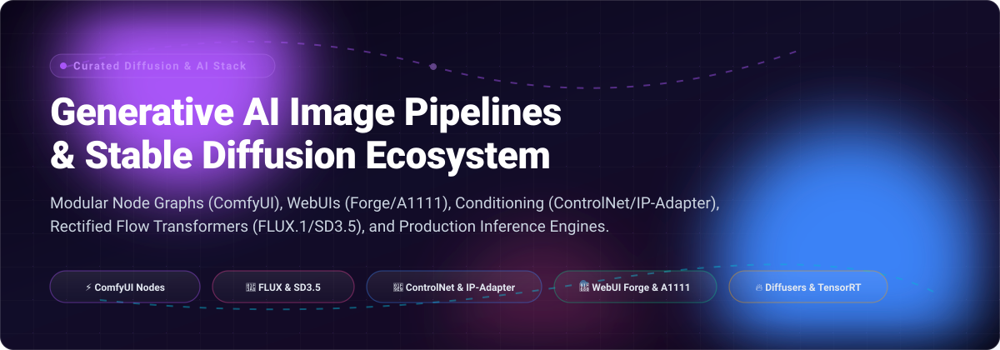

# Awesome-Generative-AI-Image-Pipelines-Stable-Diffusion

  

  
  
  
  
  

---

# 🖼️ Top Generative AI Image Pipelines & Stable Diffusion Ecosystem

> **A rigorously curated compendium of leading commercial SaaS platforms and premier open-source GitHub frameworks for state-of-the-art Generative AI image synthesis, Diffusion Models, and neural rendering pipelines.**

✨ **Focus Areas**: Node-Based Modular Pipelines (`ComfyUI`, `StableGen`), Advanced WebUIs (`AUTOMATIC1111`, `WebUI Forge`, `InvokeAI`, `Fooocus`, `SwarmUI`), Next-Gen Foundation Backbones (`FLUX.1`, `Stable Diffusion 3.5`, `SDXL`, `NVIDIA Sana`, `Kolors`), Fine-grained Conditioning (`ControlNet`, `IP-Adapter`, `IC-Light`), and High-Throughput Inference Engines (`Diffusers`, `stable-diffusion.cpp`, `OneDiff`, `ai-toolkit`, `kohya_ss`).

---

## 📑 Table of Contents

- [📊 Sector Overview & Market Dynamics](#-sector-overview--market-dynamics)
- [☁️ SaaS & Commercial AI Image Platforms](#️-saas--commercial-ai-image-platforms)
- [💻 Open-Source GitHub Projects](#-open-source-github-projects)
- [📈 Star History](#-star-history)
- [🛠️ How to Contribute](#️-how-to-contribute)
- [💖 Support & Sponsorship](#-support--sponsorship)
- [⚠️ Disclaimer](#️-disclaimer)

---

## 📊 Sector Overview & Market Dynamics

The global Generative AI Image Synthesis, Creative Diffusion Tooling & Neural Media Pipeline market is estimated at **$8.4B–$11.5B+ in 2026**, expanding at a rapid **~28%–36% CAGR** driven by the widespread transition to Multimodal Diffusion Transformers (MMDiT), Flow Matching / Rectified Flow architectures, and automated node-graph studio workflows. 

The market dynamics exhibit a **bifurcated structure**: the proprietary SaaS consumer and enterprise creative suite layer is **highly concentrated** around early-mover hyperscalers and frontier labs (OpenAI, Adobe Firefly, Midjourney, and Canva/Leonardo.ai), while the underlying workflow orchestration, spatial conditioning (`ControlNet`), local model quantization, and low-latency production inference layers are **moderately fragmented and overwhelmingly led by vibrant open-source ecosystems** (`ComfyUI`, `Hugging Face Diffusers`, `WebUI Forge`, `llama.cpp/stable-diffusion.cpp`).

---

## ☁️ SaaS & Commercial AI Image Platforms

*Commercial text-to-image and generative image synthesis suites, sorted descending by company scale (valuation / annual revenue).*

| Platform | Description | Company Scale (Valuation / Revenue) | Starting Paid Tier | Free Tier / Trial Limit |
| :--- | :--- | :--- | :--- | :--- |
| **[OpenAI (DALL·E 3 / GPT Image)](https://openai.com)** | Multimodal text-to-image synthesis and inpainting integrated within ChatGPT and developer REST APIs. | **~$157B+ Valuation** (~$4B+ ARR run-rate) | **$20 / month** (ChatGPT Plus) or **$0.040 – $0.080 / image** via OpenAI Images API | **Forever Free Plan** (Limited daily standard-resolution generations in ChatGPT Free; pay-as-you-go API) |
| **[Adobe Firefly](https://adobe.com/products/firefly.html)** | Commercially safe generative fill, text-to-image, and vector generator trained on licensed Adobe Stock. | **Part of Adobe Inc.** (~$21.5B+ annual revenue; ~$220B+ market cap) | **$4.99 / month** for Firefly Standard (100 generative credits/mo; bundled in Creative Cloud) | **Forever Free Plan** (**25 free generative credits/month** with watermarked downloads on free Adobe IDs) |
| **[Leonardo.ai (Canva)](https://leonardo.ai)** | Creative studio platform offering real-time generation, Canvas editor, and custom LoRA fine-tuning. | **Acquired by Canva for ~$370M+** (Part of $26B+ Canva valuation; ~$2.5B+ ARR) | **$10 / month** billed annually ($12/mo monthly for Apprentice plan, 8,500 fast tokens/mo) | **Forever Free Plan** (**150 fast tokens daily** resetting every 24 hours with public visibility) |
| **[Black Forest Labs (FLUX.1 Pro API)](https://blackforestlabs.ai)** | Frontier 12B parameter Rectified Flow transformer models (`FLUX.1 [pro]`, `FLUX.1.1 [pro]`, `FLUX Kontext`). | **~$1.0B+ Valuation** ($31M+ Series A; founded by original Stable Diffusion inventors) | **$0.03 – $0.06 / image** pay-as-you-go via BFL API (or ~$10/mo through fal.ai/Replicate) | **Free Open-Weight Apache 2.0 Local Model** (`FLUX.1 [schnell]` free forever; partner cloud trial credits) |
| **[Midjourney](https://midjourney.com)** | Benchmark artistic generative engine renowned for photo-realism, style reference (`--sref`), and consistency. | **~$300M+ Annual Revenue** (Bootstrapped, highly profitable independent research lab) | **$8 / month** billed annually ($10/mo monthly for Basic Plan, ~200 fast GPU minutes/mo) | **No Perpetual Free Tier** (Time-limited promotional trial periods; standard use requires $10/mo subscription) |
| **[Stability AI (DreamStudio & Developer Cloud)](https://stability.ai)** | Commercial cloud API hosting Stable Diffusion 3.5 Large, SDXL, Stable Video Diffusion, and Fast APIs. | **~$1.0B Peak Valuation** ($80M+ fresh institutional financing in 2024/2025) | **$0.030 – $0.065 / image** (SD 3.5 Large via API; credit packages start at $10 for 1,000 credits) | **Free Starter API Credits / Local Weights** (**25 free credits** on account creation + non-commercial/Community license) |
| **[Ideogram](https://ideogram.ai)** | Pioneering text-to-image platform known for industry-leading typography rendering, graphic design, and Canvas. | **~$300M–$500M+ Valuation** ($80M+ Series A led by Andreessen Horowitz) | **$7 / month** billed annually ($8/mo monthly for Basic Plan, 400 priority prompt credits/mo) | **Forever Free Plan** (**10 slow prompt credits/week** (~40 images/week) with public gallery visibility) |
| **[Recraft](https://recraft.ai)** | Professional vector and raster design studio delivering editable SVGs, 3D graphics, and brand palettes. | **~$150M–$300M Est. Valuation** ($12M+ Series A; #1 ranked model on Hugging Face T2I Arena) | **$10 / month** billed annually ($12/mo monthly for Basic plan, 1,000 credits/mo) | **Forever Free Plan** (**50 daily credits** renewing every 24 hours with public generation rights) |
| **[NightCafe](https://nightcafe.studio)** | Multi-engine generative community platform aggregating SDXL, FLUX, DALL·E 3, and daily art contests. | **~$10M–$25M Est. Scale** (Bootstrapped independent Australian studio; >25M registered users) | **$4.79 / month** billed annually ($5.99/mo monthly for AI Beginner, 100 credits/mo) | **Forever Free Plan** (**5 free credits every day** + free base SDXL and FLUX.1 [schnell] batch runs) |
| **[Artbreeder](https://artbreeder.com)** | Collaborative AI art suite featuring genetic image breeding, Collager composition, and portrait Mixer. | **~$10M–$20M Est. Scale** (Independent creative venture; >10M registered creators) | **$7.49 / month** billed annually ($8.99/mo monthly for Starter plan, 100 credits/mo) | **Forever Free Plan** (**10 free credits/month** with unlimited remixing and standard resolution) |

---

## 💻 Open-Source GitHub Projects

*Leading open-source diffusion interfaces, node-graph engines, foundational model weights, and conditioning tools — sorted descending by GitHub Star Count.*

| Project | Stars | Category / Stack | Description |
| :--- | :---: | :--- | :--- |
| **[stable-diffusion-webui](https://github.com/AUTOMATIC1111/stable-diffusion-webui)** |  | 🎛️ Comprehensive WebUI | The foundational browser interface for Stable Diffusion (A1111) with extensive extension ecosystem. |
| **[ComfyUI](https://github.com/comfyanonymous/ComfyUI)** |  | ⚡ Modular Node Graph | The most powerful, modular node-based diffusion execution engine, backend, and API for SD & FLUX. |
| **[stable-diffusion](https://github.com/CompVis/stable-diffusion)** |  | 🧠 Original Latent Model | Original research release of High-Resolution Image Synthesis with Latent Diffusion Models by CompVis. |
| **[Fooocus](https://github.com/lllyasviel/Fooocus)** |  | 🎨 Minimalist WebUI | Streamlined Midjourney-like local offline generation software with automated prompt expansion & styling. |
| **[diffusers](https://github.com/huggingface/diffusers)** |  | 🛠️ Core PyTorch Library | Hugging Face's definitive library for state-of-the-art diffusion models across image, video, and audio. |
| **[ControlNet](https://github.com/lllyasviel/ControlNet)** |  | 🧩 Spatial Conditioning | Revolutionary neural network architecture adding spatial conditioning controls (depth, canny, pose). |
| **[InvokeAI](https://github.com/invoke-ai/InvokeAI)** |  | 🖌️ Creative Studio GUI | Professional creative suite offering infinite canvas, unified workflow boards, and node customization. |
| **[generative-models](https://github.com/Stability-AI/generative-models)** |  | 📦 Official Stability Models | Official Stability AI codebase hosting SDXL 1.0, Stable Video Diffusion (SVD), and cascade pipelines. |
| **[flux](https://github.com/black-forest-labs/flux)** |  | 🚀 Rectified Flow Model | Official reference implementation and local inference repository for FLUX.1 Rectified Flow models. |
| **[ComfyUI-Manager](https://github.com/ltdrdata/ComfyUI-Manager)** |  | 🔌 Ecosystem Extension | Essential package manager for ComfyUI to discover, install, update, and resolve missing custom nodes. |
| **[stable-diffusion-webui-forge](https://github.com/lllyasviel/stable-diffusion-webui-forge)** |  | ⚡ Optimized WebUI | Low-VRAM accelerated fork of A1111 with advanced UNet memory management and native FLUX support. |
| **[ai-toolkit](https://github.com/ostris/ai-toolkit)** |  | 🏋️ LoRA & Fine-Tuning | The go-to training toolkit for high-efficiency LoRA and full fine-tuning of FLUX.1, SDXL, and SD3.5. |
| **[kohya_ss](https://github.com/bmaltais/kohya_ss)** |  | 🎚️ Training GUI | Comprehensive GUI for Kohya's Stable Diffusion training scripts supporting DreamBooth, LoRA, and Textual Inversion. |
| **[krita-ai-diffusion](https://github.com/Acly/krita-ai-diffusion)** |  | 🎨 Digital Painting Plugin | Inpainted diffusion generation, real-time live painting, and ControlNet inside the open-source Krita editor. |
| **[Sana](https://github.com/NVlabs/Sana)** |  | 💡 Fast Deep Compression | NVIDIA's high-efficiency generative model supporting up to 4K resolution with linear-time attention. |
| **[IC-Light](https://github.com/lllyasviel/IC-Light)** |  | 💡 Illumination Control | Novel framework for imposing detailed photographic relighting and consistent ambient light transport. |
| **[stable-diffusion.cpp](https://github.com/leejet/stable-diffusion.cpp)** |  | ⚙️ C/C++ Inference | Pure C/C++ inference engine for Stable Diffusion and FLUX using ggml/GGUF 4-bit/8-bit integer quantization. |
| **[automatic](https://github.com/vladmandic/automatic)** |  | 🚀 Modernized WebUI | SD.Next — Next-generation Stable Diffusion WebUI with Diffusers backend, ONNX, and modern UI enhancements. |
| **[IP-Adapter](https://github.com/tencent-ailab/IP-Adapter)** |  | 🖼️ Image Prompt Adapter | Decoupled cross-attention adapter enabling image prompts and multimodal style transfer without model retraining. |
| **[SwarmUI](https://github.com/mcmonkeyprojects/SwarmUI)** |  | 🌐 Multi-GPU Cluster GUI | Highly extensible modular WebUI powered by ComfyUI backend with multi-GPU distribution and grid generators. |
| **[Kolors](https://github.com/Kwai-Kolors/Kolors)** |  | 🌸 Multilingual Diffusion | Large-scale photorealistic text-to-image diffusion model with exceptional English and Chinese text comprehension. |
| **[fastsdcpu](https://github.com/rupeshs/fastsdcpu)** |  | 💻 CPU Optimized GUI | Fast text-to-image generation on desktop CPUs and AI PCs using OpenVINO, LCM, and Turbo models. |
| **[onediff](https://github.com/siliconflow/onediff)** |  | 🏎️ GPU Compiler Acceleration | Ultra-fast out-of-the-box acceleration compiler for HF Diffusers and ComfyUI pipelines. |
| **[stablegen](https://github.com/sakalond/stablegen)** |  | 🧊 3D Blender Integration | Generative AI pipeline bringing automated PBR texturing and Stable Diffusion directly into Blender 3D. |
| **[sd3.5](https://github.com/Stability-AI/sd3.5)** |  | 📐 MMDiT Research Repo | Reference scripts and model architectures for Stable Diffusion 3.5 Large and SD 3.5 Medium. |

---

## 📈 Star History

---

## 🛠️ How to Contribute

Contributions are welcome and highly appreciated! To submit a new project, library, or platform:

1. 🍴 Fork this repository.
2. 🌿 Create a descriptive feature branch (`git checkout -b feature/add-new-pipeline`).
3. 📝 Add your project into the corresponding table preserving descending sort order (Valuation/Revenue for SaaS, GitHub Stars for Open-Source). Ensure factual information with clickable documentation links.
4. 🚀 Push changes and open a Pull Request.

---

## 💖 Support & Sponsorship

If you find this curated ecosystem directory valuable for your research, creative projects, or production pipelines, please consider supporting the ongoing maintenance:

- ⭐ **Star this repository** to improve visibility on GitHub.
- 🍴 **Fork and share** with colleagues, AI engineers, and digital artists.
- ☕ **Support the maintainer**: You can sponsor or buy a coffee via the [GitHub Sponsors Dashboard](https://github.com/sponsors/ishandutta2007).

---

## ⚠️ Disclaimer

*All trademarks, logos, and company names mentioned herein are property of their respective owners. Inclusion in this repository does not imply endorsement.*
